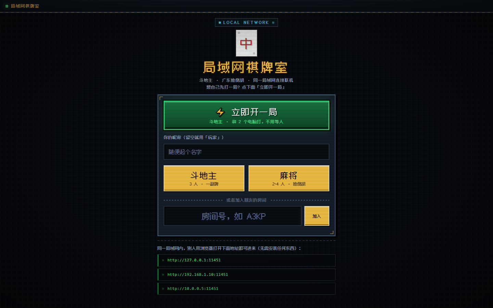
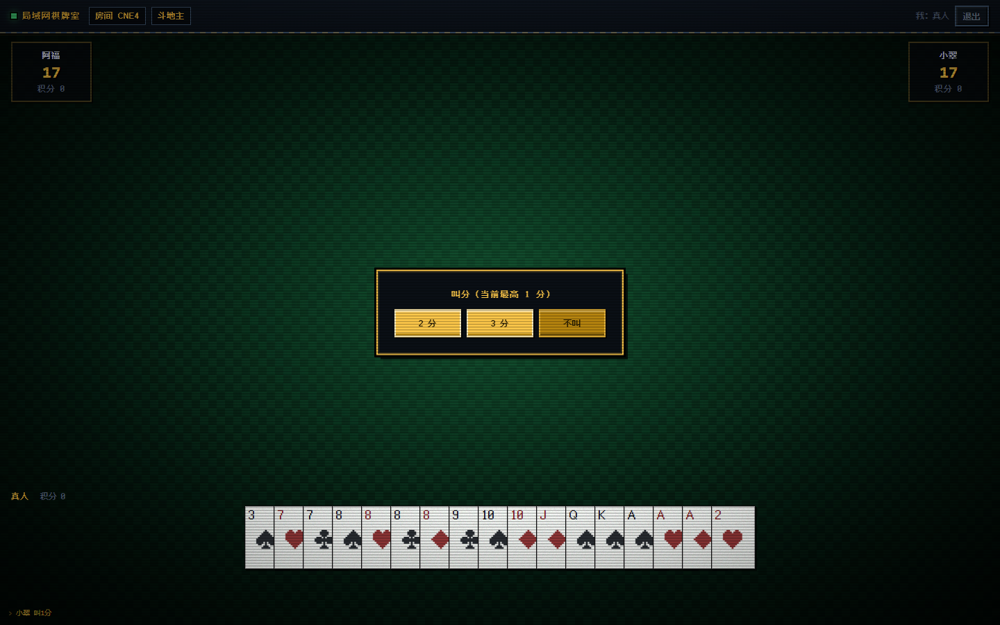
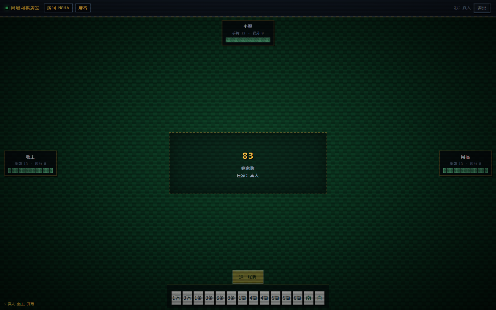

# 局域网棋牌室

> 同一局域网开一局斗地主或广东推倒胡。主机双击就能开服，其他设备打开浏览器就能玩，**谁都不用装东西**。


[](https://github.com/DLSteinsGate/qipai-lan/releases/latest)



适合的场景：宿舍、家里、小办公室、没有外网或者不想让牌局数据出局域网的地方。一台机器开服，其他人拿到一个 `http://192.168.x.x:11451` 打开就进，连 App 都不用装。

想了解设计取舍、规则实现细节、AI 的思路、为什么这么选技术，看 [ABOUT.md](ABOUT.md)。

---

## 特性

- **两种玩法**：斗地主（3 人 54 张，叫分 1/2/3 分）、广东推倒胡麻将（2~4 人）。
- **零运行时依赖**：服务端只用 Node 内置模块，`package.json` 里没有 `dependencies`。
- **可打包成单文件**：`npm run build` 产出一个约 100 MB 的 exe，Node 运行时、服务端、前端、字体、图片全在里面。拷到没装 Node 的机器上双击就跑。
- **服务端权威**：牌堆、判定、算番都在服务端，客户端只发动作、收状态。别人的手牌从不下发。
- **真人 + AI 混桌**：缺人可以「补一个 AI」，AI 也能直接开局陪练。
- **复古像素风界面**：硬边、硬影、CRT 扫描线，内嵌像素字体（不联网、不依赖系统字体）。
- **矮屏友好**：1366×768 / 1280×800 这类笔记本屏不用滚动就能看到局域网地址。

## 截图

| 斗地主 | 麻将 |
| --- | --- |
|  |  |

---

## 快速开始

### 方式一：单文件 exe（不需要 Node）

到 [Releases](https://github.com/DLSteinsGate/qipai-lan/releases/latest) 下载 `qipai-lan-vX.Y.Z-win-x64.exe`，放任意目录双击（改名叫 `局域网棋牌室.exe` 也行，名字不影响运行）。控制台会打印地址：

```
本机打开：  http://localhost:11451
同一 WiFi/局域网的其他电脑或手机，打开：
    http://192.168.1.10:11451  (以太网)
```

把局域网那行发给朋友即可。**只有一个文件要拷，目标机器不需要 Node、不需要 npm install、不需要任何运行库。**

exe 会自己打开浏览器。启动失败（端口全被占、端口号写错）时会停住窗口等你按回车，错误信息不会一闪而过。想关掉自动开浏览器：`set OPEN_BROWSER=0` 后再双击，或在命令行里 `set OPEN_BROWSER=0 && 局域网棋牌室.exe`。

### 方式二：源码运行（需要 Node ≥ 22）

```bash
git clone https://github.com/DLSteinsGate/qipai-lan.git
cd qipai-lan
node server/index.js
```

源码运行不会自动开浏览器，自己打开 <http://localhost:11451> 即可。点「⚡ 立即开一局」直接和两个电脑开打，不用起名、不用等人。

### 端口

默认 **11451**，可用环境变量改：

```bash
PORT=20000 node server/index.js          # Linux / macOS
set PORT=20000 && node server\index.js   # Windows cmd
```

被别的程序占用时会自动往后顺延（11452、11453…），窗口里打印的永远是**实际**在用的端口，照它打开就行。

### 别人连不上？

首次启动 Windows 可能弹「是否允许访问网络」，选**允许**（专用网络即可）。当时点了取消的话，用管理员 PowerShell 放行：

```powershell
New-NetFirewallRule -DisplayName "局域网棋牌室 11451" -Direction Inbound -Protocol TCP -LocalPort 11451 -Action Allow -Profile Private
```

---

## 玩法

**自己先打一局**：首页点「⚡ 立即开一局」，直接发牌（你和 2 个电脑）。

**和朋友联机**：

1. 一方输入昵称 → 选「斗地主 / 麻将」→ 得到 4 位房间号。
2. 其他人输入昵称 + 房间号 → 「加入」。
3. 房主可以「＋ 补一个 AI」补位，人齐了点「开始游戏」。
4. 结算后「再来一局」，积分跨局累计。

昵称留空会自动叫「玩家」，不拦人。

**规则范围**

- **斗地主**：叫分 1/2/3 分，炸弹与王炸翻倍，春天/反春再翻倍。牌型含单张、对子、三张、三带一/二、顺子、连对、飞机、四带二、炸弹、王炸。
- **麻将**：广东推倒胡，吃 / 碰 / 明杠 / 暗杠 / 补杠 / 抢杠胡。番型有平胡、碰碰胡、混一色、清一色、七对、十三幺、自摸等，番数封顶 64。
- 牌桌左下角是实时对局日志（最近 6 条），写明谁出了什么牌；顺子、连对、飞机只写首尾（`出了顺子 7-Q`），带牌型把主牌排前面（`出了三带一 J♠ J♥ J♣ 3♦`）。

---

## 打包成单文件

```bash
npm run build
# 或指定输出名
node tools/build-sea.js 棋牌室-1.2.exe
```

输出 `局域网棋牌室.exe`（约 100 MB）。用的是 Node 内置的 SEA（Single Executable Application，`--build-sea`，Node ≥ 25.5 提供），**不需要 postject 之类的第三方工具**。

打包器会把 `server/**/*.js` 与 `public/**` 全量内嵌，运行期由一个自定义模块加载器接管 `require`，所以 exe 里跑的就是这套源码，业务代码零改动。

**想改界面又不想重新打包**：在 exe **同目录**放一个 `public` 文件夹，里面放哪些文件就覆盖哪些，没放的照旧用内嵌资源（逐文件生效）。

---

## 技术实现

```
server/index.js                 HTTP + SSE 服务，房间与动作路由
server/static.js                静态资源层（源码运行 / 单文件 exe 双形态）
server/pause.js                 exe 形态下退出前停住窗口，避免报错一闪而过
server/util.js                  房间号、随机数工具
server/games/ddz-rules.js       斗地主牌型识别 / 比大小 / 枚举
server/games/ddz.js             斗地主流程 + AI
server/games/mahjong-rules.js   麻将胡牌 / 听牌 / 算番 / AI 评估
server/games/mahjong.js         麻将流程 + AI

public/index.html               单页入口
public/css/style.css            视觉系统（像素风变量与组件）
public/js/net.js                接口封装（create / action / SSE）
public/js/ui.js                 通用 UI 原子（卡牌、toast、确认框）
public/js/app.js                首页、大厅、结算的主流程
public/js/games/ddz-view.js     斗地主牌桌渲染
public/js/games/mahjong-view.js 麻将牌桌渲染
public/fonts/                   内嵌像素字体 + 许可全文
public/img/                     王牌素材转出的 PNG + 纸面贴片

joker/                          原始王牌素材（bmp，仅作来源留档，不参与构建）
tools/build-sea.js              打包器：产出单文件 exe
tools/sea-bootstrap.js          exe 内的模块加载引导
tools/shot-home.js              截图脚本（生成 README 首页图）
test/                           规则、模拟、接口、UI 全流程测试
```

**通信模型**：HTTP 长连（SSE）推状态，POST 发动作。没有 WebSocket、没有框架、没有构建步骤——前端就是几个直接用 `<script>` 引入的文件。

```
GET  /api/info                 局域网地址、端口、房间列表
POST /api/create               建房（返回 roomId / token / seat）
POST /api/join                 按房间号加入
GET  /api/room?roomId=XXXX     房间快照
GET  /api/stream?token=...     SSE 订阅，服务端推 state / event / lobby
POST /api/action               所有游戏动作（bid / play / pass / discard / claim / zimo / gang /
                               addAI / removeAI / start / nextRound / leave）
```

**为局域网做的一些取舍**：状态全在内存（不落盘，不引数据库）；牌局数据不对外发送，只下发自己的手牌；AI 用简单规则而不是搜索，避免拖慢单核；同一房间的推送走一条 SSE 连接。

### 界面风格

整体是复古电子 / 街机像素风：全硬边（无圆角）、无模糊位移硬影、双色内描边模拟 8-bit 立体边框，全屏叠一层 CRT 扫描线与暗角。

字体**本地内嵌**，不联网、不依赖系统字体：

| 字体 | 文件 | 用途 | 许可 |
| --- | --- | --- | --- |
| [Fusion Pixel Font](https://github.com/TakWolf/fusion-pixel-font) | `public/fonts/fusion-12px-zh_hans.woff2` | 主字体 | SIL OFL 1.1，全文见 `public/fonts/OFL-fusion-pixel.txt` |

像素字体在**字号为 12 的整数倍**时最锐利，所以界面字号统一取 12 / 24 / 36。

配色变量集中在 `public/css/style.css` 顶部的 `:root`：底色四级台阶、琥珀主色 `--amber`、磷光绿 `--green`、警示红 `--red`、终端青 `--cyan`，改一处即可整体换肤。

牌面纹理取自 `joker/` 里的王牌素材：扑克牌、麻将牌、首页的麻将图标共用同一套「外 1px 近黑 + 内 1px 浅灰 + 带极轻颗粒的纸面」，纸面颗粒是从素材里采样出 `public/img/paper-tile.png`（128×128）平铺的，不是凭空画的渐变。大小王直接用素材原图，按 71:96 等比铺满，`image-rendering: pixelated` 保证放大不糊。

首页在矮屏上自动收紧（`max-height: 880px` / `740px` / `640px` 三档断点）。`prefers-reduced-motion` 下自动关掉扫描线与动画。

---

## 测试

```bash
node test/rules.test.js    # 53 条牌型 / 胡牌规则用例
node test/sim.test.js      # AI 对 AI 跑完整局（较慢，约 6~9 分钟）
node test/http.test.js     # 52 项接口 + SSE 校验（需服务已启动）
node test/ui.test.js       # 真实浏览器打完整局（需服务已启动 + 本机 Chrome）
```

`ui.test.js` 只看麻将可加 `SKIP_DDZ=1`；Chrome 不在默认位置时用 `CHROME_PATH` 指定；服务不在默认端口用 `BASE=http://127.0.0.1:11452`。后两个测试需要 `npm install`（只为 `playwright-core`）。

## 已知限制

- 服务端状态全在内存，重启服务所有房间消失。
- 断线不会自动重连补局，刷新页面会回到首页（房间还在，可以重新加入）。
- 房间号 4 位随机，小概率撞号，撞了重新创建即可。
- 单文件 exe 只在 Windows 上验证过；SEA 本身跨平台，其它平台的产物没有测试。
- exe 靠控制台窗口承载日志。把它关掉（或按 Ctrl+C）服务就停了，**这个窗口要留着**。想彻底后台运行，用 `start /min 局域网棋牌室.exe` 最小化启动。

## 许可

[PolyForm Noncommercial License 1.0.0](LICENSE) —— **源码公开，禁止商用**。

- ✅ 个人使用、学习研究、兴趣爱好、课堂教学、非商业组织内部使用
- ✅ 读代码、改代码、fork、给别人看
- ❌ 拿去卖、拿去做收费产品、拿去挂在有广告的站点上运营、拿去做客户交付

商业授权请开 issue 或直接联系作者。

字体是 SIL OFL 1.1，与上面的代码许可相互独立，可自由使用与再分发（保留许可文本即可）。
